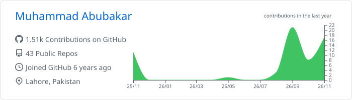
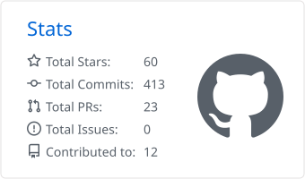
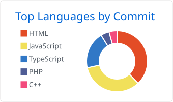

  

<h1 align="center">Hi, I'm Muhammad Abubakar 👋</h1>

  

  
  
  
  

## About me

I'm a full stack web developer based in Lahore, Pakistan, building robust and scalable web applications. I work across the front end and the back end, with a keen eye for user experience and performance.

- 🌱 **Currently learning:** Large Language Models and other AI stuff
- 💬 **Ask me about:** MERN, MEAN, DevOps, Cloud, and System Design
- ⚡ **Fun fact:** I run on pure logic and creativity. No coffee or tea required!

## Tech stack

  

## GitHub stats

  <picture>
    <source media="(prefers-color-scheme: dark)" srcset="./profile-summary-card-output/github_dark/0-profile-details.svg" />
    
  </picture>

  <picture>
    <source media="(prefers-color-scheme: dark)" srcset="./profile-summary-card-output/github_dark/3-stats.svg" />
    
  </picture>
  <picture>
    <source media="(prefers-color-scheme: dark)" srcset="./profile-summary-card-output/github_dark/2-most-commit-language.svg" />
    
  </picture>

  <picture>
    <source media="(prefers-color-scheme: dark)" srcset="https://streak-stats.demolab.com?user=abubakarwebdev&theme=github-dark-blue&hide_border=true" />
    
  </picture>

